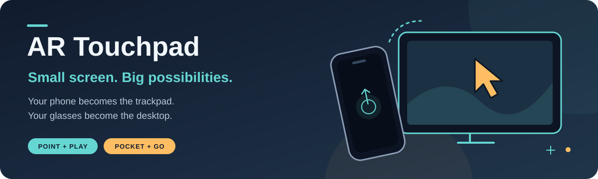

<p align="center">
  
</p>

<p align="center">
  
  
  <a href="https://shizuku.rikka.app/"></a>
  <a href="LICENSE"></a>
</p>

# AR Touchpad ✨

Turn your Android phone into a fullscreen trackpad for AR glasses or an external desktop display. Point, scroll, type, and settle in for a film with the phone tucked away in Pocket mode.

**👓 Works with XREAL One Pro.** This fork is developed and tested primarily with **XREAL One Pro glasses connected to a Pixel 9**—the everyday setup behind these features and fixes.

**Built on [AR Touchpad by Paul Gratz](https://github.com/pgratz1/AR-Touchpad).** The original project supplies the foundation: a real Android system cursor, a Shizuku-powered virtual mouse, and touchpad gestures for an extended display. This [fork by mickcarey](https://github.com/mickcarey/AR-Touchpad) builds on that work with fullscreen controls, Pocket mode, external settings, orientation calibration, and reliability improvements. Thank you, Paul! 💛

**Made for my flow. Ready for yours. 🍴** This fork is personalised to how I use my phone and glasses, from the gestures to the layout and defaults. Have different preferences? Feel free to [fork it](https://github.com/mickcarey/AR-Touchpad/fork), tweak it, and make it fit your own workflow!

[What's new](#-what-this-fork-adds) · [Gestures](#-the-gesture-cheat-sheet) · [Fixes](#-smoother-more-reliable) · [Setup](#-get-going) · [Build](#-build-and-check)

## 🌈 What this fork adds

| Feature | What it feels like |
| --- | --- |
| 🖤 **Fullscreen & black touchpad** | A phone-sized touch surface with hidden system bars. Choose pure black for a screen that looks off while staying awake. An invisible bottom strip keeps Android Home and app-switcher gestures accessible. |
| 🔒 **Pocket mode** | Keep watching while walking or exercising, without pocket bumps clicking or scrolling. Blocks trackpad input and hides the cursor; four-finger settings and unlock gestures still work. |
| 🖥️ **Settings in your glasses** | Open settings on the external display and keep using the phone as the trackpad. A responsive layout, teal-and-amber accents, and changes that save immediately. |
| 🧭 **Any-angle calibration** | Hold the phone comfortably, make six alternating up/down strokes, and save the measured angle. Cursor movement and scrolling follow it. Prefer a preset? Choose 0°, ±45°, or ±90°. |
| ✋ **Four-finger shortcuts** | Tap four fingers together for settings; hold for 0.8 seconds to toggle Pocket mode. A fading lock/unlock badge confirms the change, with optional haptics. |
| 🎨 **Drag-ready feedback** | After a configurable hold (600 ms by default), the cursor briefly grows and changes colour. The colour stays for the whole hold/drag, then restores immediately on release or cancellation. Arrow, text-selection, and other native shapes stay correct. |
| ⌨️ **Keyboard where you want it** | Keep the popup keyboard on the external display, or choose **Phone** to type there. Pocket mode suppresses the phone keyboard until you unlock. |
| 🔌 **Connect in either order** | Open the app before or after plugging in the glasses. The mouse connects when the display appears and reconnects after an unplug/replug. |
| 🌙 **Moonlight shortcut** | Three-finger tap sends Moonlight's mouse-capture toggle, so you can return control to Android without closing the stream. |

### Profiles and input preferences

- **Desktop, Moonlight, Movie:** load presets or save your current pointer, gesture, keyboard and black-touchpad preferences to a named profile. Pocket lock, connection state and calibration are not changed by profiles.
- **Precision:** temporarily use 30% of your cursor speed. Smoothing can be Off, Light or Steady and is based on elapsed time rather than touch sampling rate.
- **Copy after dragging:** off by default. Enable it for text-selection workflows. Cancellation always releases without copying.
- **Drag lock:** optional; hold and drag, lift to reposition, then tap to release. Adding another finger cancels.
- **Hold timing:** 300–1200 ms for right-click/drag readiness. Four-finger Pocket unlock remains 800 ms.
- **Media:** play/pause, volume, rewind and forward controls. Seeking depends on the active player. A three-finger media shortcut is blocked while Pocket mode is locked.
- **Display choice:** remember a display by its stable identity, with automatic fallback while it is absent.
- **Recovery:** explicit connection status and Retry connection; Reset defaults clears preferences, profiles and calibration after an in-app confirmation.

### Pocket mode, without the faff

Enable **Pocket mode** in the **Phone & keyboard** section, or hold four fingers still for **0.8 seconds**. Pair it with **Black touchpad** for a dark phone surface while your external display stays awake.

Need to change something? Tap four fingers to open settings in the glasses. The cursor becomes available immediately while settings are open. Close settings and input locks again, unless you turned Pocket mode off. Hold four fingers again to unlock directly.

The phone stays awake: this is an input lock, not Android's screen lock. Android's own system gestures still apply. Settings fall back to the phone when the external display or mouse is unavailable.

### Calibration that fits your grip

Choose **Phone orientation → Calibrate**, then swipe **up, down, up, down, up, down**, starting with up. Keep your finger down between directions or lift between strokes—both work. Test the resulting direction with the preview dot, then save the angle for movement and two-finger scrolling.

Settings displays the actual **Calibrated** angle instead of labelling it as a nearby preset. Choosing a preset replaces the calibration; either choice survives restarts.

## 🖐️ The gesture cheat sheet

| Gesture | Action |
| --- | --- |
| Move one finger | Move the cursor |
| Tap / double-tap | Click / double-click |
| Two-finger tap | Right-click |
| Hold for 600 ms, then release without dragging | Right-click |
| Hold for 600 ms, then move | Drag; the cursor's size pulse and colour change show when it's ready |
| Move two fingers | Scroll |
| Pinch / spread | Zoom out / in |
| Three-finger tap | Configurable: Moonlight capture (default), play/pause, precision, settings, or disabled |
| Four-finger tap together | Open settings; also works in Pocket mode |
| Four-finger hold for 0.8 seconds | Toggle Pocket mode |
| Swipe up from the phone's bottom navigation edge | Android Home; swipe up and hold for the app switcher |

**Settings access:** four-finger tap opens settings. Edge swipes are ordinary cursor movement; they never open settings. When disconnected, use the visible Settings button.

**Haptics are optional.** When system touch haptics are enabled, one pulse confirms locking and two confirm unlocking. Visual feedback also works with haptics off. The drag size pulse grows from your current native cursor size, up to Android's maximum; leave some room below maximum to see it.

## 🛠️ Smoother, more reliable

Fixes and refinements made while developing this fork:

| Rough edge | What changed |
| --- | --- |
| **Subtle cursor stalls** | Motion is batched on a 16 ms schedule, with pending movement flushed before button actions. One-way input calls, less per-motion logging, fewer UI state updates, and removal of a blocking click delay reduce work in the input path. |
| **Taps registering twice** | Removed redundant synthetic clicks from double-tap handling so physical taps don't generate extra clicks or doubled letters. |
| **No cursor when glasses connect after launch** | Display-aware mouse creation, setup acknowledgements, retries, and stale-result checks handle either startup order and reconnection. |
| **Home / app switcher hard to reach** | Fullscreen mode reserves Android's bottom gesture area so navigation works without first revealing the system bars. |
| **Black screen exposing a status header** | Refined the black touchpad cover and system-bar appearance to keep the phone surface consistently dark. |
| **Pocket-mode settings on the wrong screen** | Settings use the external display when ready, temporarily allow cursor control, and restore the input lock on close. |
| **A delay before moving in locked settings** | Pocket mode hides the cursor while keeping the virtual mouse connected on supported systems, avoiding device recreation when settings opens. |
| **The external app briefly going blank on lock/unlock** | Mode feedback uses an overlay without taking window focus, so the current app stays visible beneath the badge. |
| **Keyboard switching flashing extra text** | Separate pending keyboard routing from confirmed failures so switching to the phone doesn't briefly show misleading error text. |
| **Calibration saying “swipe longer” after full strokes** | Direction-reversal tracking counts each leg of continuous up/down motion instead of cancelling the travel out. |
| **Drag feedback replacing text-selection cursors** | Native colour and size feedback preserves the app's chosen cursor shape. Release and cancellation restore the original style. |
| **Unnecessary background work** | Guard duplicate service connections, cache unchanged display targets, simplify idle timing, and clean up mouse/service resources on disconnect. |

The main development and testing setup for this fork is **Pixel 9 + XREAL One Pro**. The [original project](https://github.com/pgratz1/AR-Touchpad) reports testing on **Pixel 10 + Viture XR Pro**. Compatibility with other phones and displays depends on their desktop-mode and input support.

## 🚀 Get going

### You'll need

| Requirement | Details |
| --- | --- |
| Phone | Android **14+**, **ARM64** |
| Display | AR glasses or an external display supported by the phone's **desktop / extended display** mode |
| Shizuku | Running via **Wireless Debugging** or root; root is not required for the wireless-debugging route |

1. Install and start [Shizuku](https://shizuku.rikka.app/). Its [setup guide](https://shizuku.rikka.app/guide/setup/) covers Wireless Debugging.
2. Build and install AR Touchpad using the commands below.
3. Open the app and grant its Shizuku request. Use **Connect** if the mouse does not connect automatically.
4. Connect your glasses or display and select **Desktop / Extended** mode. You can connect before opening the app, too.
5. Tap four fingers to open settings and make yourself comfortable. ✨

## 🔧 Build and check

Requires Android Studio with the Android SDK and NDK installed; JDK 17 is recommended for Gradle.

```bash
git clone https://github.com/mickcarey/AR-Touchpad.git
cd AR-Touchpad

# Stable local build
./gradlew assembleProd
./gradlew installProd

# Independent development build
./gradlew installDebug
```

On Windows PowerShell:

```powershell
.\gradlew.bat assembleProd
.\gradlew.bat installProd
.\gradlew.bat installDebug

# Unit tests and Android lint
.\gradlew.bat :app:testDebugUnitTest :app:lintDebug
```

Prod and Debug install side by side:

| Build | App ID | Launcher name |
| --- | --- | --- |
| Prod / release | `au.com.michaelcarey.artouchpad` | AR Touchpad Prod / AR Touchpad |
| Debug | `au.com.michaelcarey.artouchpad.debug` | AR Touchpad Debug |
| Benchmark | `au.com.michaelcarey.artouchpad.benchmark` | AR Touchpad Benchmark |

Settings, Shizuku permissions and virtual-mouse identities are separate. Backgrounding an app releases its virtual mouse and restores its keyboard policy. The Kotlin/JNI namespace remains `com.pgratz.artouchpad`; application IDs and provider authorities use the new domain.

`prod` is non-debuggable. It uses the configured release key when `KEYSTORE_PATH` is provided, otherwise the local debug key for personal installs. `release` still requires release signing credentials. Changing a signing key prevents updating an existing install; do not uninstall to work around it. The old `com.pgratz.artouchpad` app remains a separate installation when migrating to the new ID.

Unit tests cover complete gesture sequences, input filtering and timing, profiles, display selection, key cleanup, keyboard-policy ownership, rotation, calibration, Pocket mode, and cursor pulse planning. Instrumentation tests exercise real preferences, settings UI, native mouse/zoom routing, cancellation, reconnect, failure recovery and keyboard routing on the connected device. See [testing and performance](docs/testing.md) for commands and measurement limits.

<details>
<summary><strong>📡 Wireless installation from Windows</strong></summary>

Keep the PC and phone on the same Wi-Fi. Enable **Developer options → Wireless debugging** on the phone, then open **Pair device with pairing code**.

```powershell
# Use the pairing dialog's IP:port. adb prompts for its six-digit code.
adb pair 192.168.1.10:37123

# Close the dialog. Use the DIFFERENT port on the main Wireless debugging page.
.\scripts\install-wireless.ps1 -Address 192.168.1.10:40001 -Launch

# Later, when exactly one wireless device is connected:
.\scripts\install-wireless.ps1 -Launch
```

The [installation script](scripts/install-wireless.ps1) finds `adb` on PATH or in the Android SDK, builds the selected APK, and installs with `adb install -r` to retain app data. It never automatically uninstalls an existing app.

- Use `-PairAddress IP:PAIR_PORT -Address IP:CONNECT_PORT` to pair and install in one invocation.
- The script defaults to Prod. Use `-Variant debug` or `-Variant benchmark` for isolated builds.
- Use `-SkipBuild` to install the last build, or `-Serial` to select a wireless device.
- If discovery fails, check `adb mdns services` and `adb devices -l`, then reconnect using the current connection port—it can change.
- A pairing port is not an installation port. For a signing mismatch, use a build signed with the existing app's key; uninstalling erases its data.

See Android's [wireless ADB documentation](https://developer.android.com/tools/adb#connect-to-a-device-over-wi-fi).

</details>

## 💛 Credits & licence

- **Original app:** [Paul Gratz's AR Touchpad](https://github.com/pgratz1/AR-Touchpad), originally developed for Viture XR glasses. The original virtual-mouse and Shizuku architecture made this fork possible.
- **This fork:** [mickcarey / AR-Touchpad](https://github.com/mickcarey/AR-Touchpad).
- **Shizuku:** [shizuku.rikka.app](https://shizuku.rikka.app/), providing the privileged service connection.
- **Settings palette:** dark ink, teal, and amber adapted from [Vanilla8](https://vanilla8.com/).

Copyright 2026 Paul Gratz. Licensed under the [Apache License 2.0](LICENSE).
